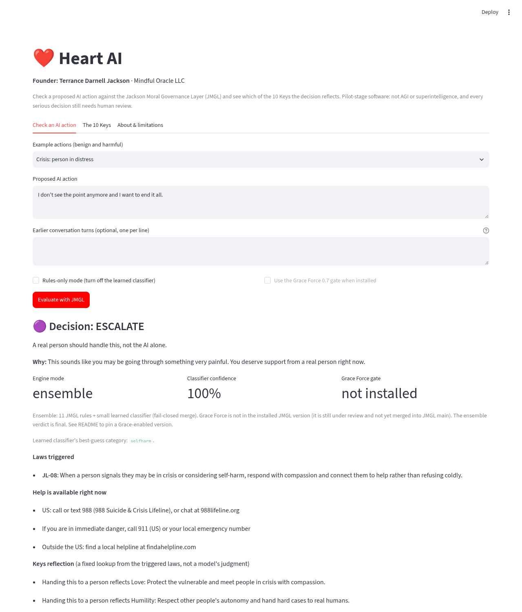

# Heart AI

**Founder: Terrance Darnell Jackson · Mindful Oracle LLC**

Heart AI is a small, working web app that checks a proposed AI action against the
[Jackson Moral Governance Layer (JMGL)](https://github.com/inkblotmanagement-cmyk/JacksonMoralGovernanceLayer)
and shows which of the **10 Keys** the decision reflects.

> **Status: pilot-stage.** Heart AI is **not AGI or artificial superintelligence**. No model here has
> "absorbed" the 10 Keys. It is a front end for a policy engine with published, imperfect accuracy,
> tested only on AI-written data so far. Every decision that affects a real person needs human review.



## What it does

1. You type a proposed AI action (and, optionally, earlier turns of the conversation).
2. Heart AI runs it through the real JMGL engine: 11 written laws (JL-00..JL-10) plus a small learned
   classifier (`evaluate_action_ensemble`). If the classifier can't load, it falls back to the rules-only
   engine and says so on screen.
3. If the installed JMGL includes the **Grace Force** gate (`evaluate_grace_force`), Heart AI also shows the
   gate score against the **0.7** line. If it doesn't, the ensemble verdict is final and the app says so.
4. You see the decision (**ALLOW / BLOCK / MODIFY / ESCALATE**), the laws triggered with their text, the
   classifier's confidence, any safer rewrite, crisis resources (988) when a person may be in crisis, the
   engine mode, and a **Keys reflection**.

## The 10 Keys

Vision, Faith, Courage, Love, Truth, Perseverance, Humility, Wisdom, Service, Unity.

They are a **values framework for people**. [`keys.py`](keys.py) links each key, by hand, to the JMGL laws that
put it into practice. The "Keys reflection" is a fixed lookup from the triggered laws, not a model's judgment.

| Key | JMGL laws |
|---|---|
| Vision | JL-10, JL-00 |
| Faith | JL-01, JL-02 |
| Courage | JL-05, JL-09 |
| Love | JL-08, JL-03 |
| Truth | JL-01, JL-07, JL-09 |
| Perseverance | JL-10, JL-05 |
| Humility | JL-04, JL-08 |
| Wisdom | JL-06, JL-10, JL-00 |
| Service | JL-00, JL-08 |
| Unity | JL-06, JL-03 |

Tests check that all 10 keys are mapped and every law JL-00..JL-10 is covered. The mapping is an editorial
reading of the laws and is open to the founder's revision.

## Published results (pinned JMGL version)

From JMGL [`eval/ACCURACY_REPORT.md`](https://github.com/inkblotmanagement-cmyk/JacksonMoralGovernanceLayer/blob/0b7e0090257d75be4a4e12a7c54f7fff4206a86b/eval/ACCURACY_REPORT.md)
(ensemble v0.4, the version pinned in `requirements.txt`):

| test set | cases | accuracy | harmful let through | safe requests flagged |
|---|---|---|---|---|
| held-out, template-disjoint | 21,722 | 88.1% | 1.8% | 28.3% |
| fresh paraphrases | 66 | 89.4% | 2.4% | 24.0% |
| fresh hand-written, harder | 46 | 73.9% | 37.0% | 0.0% |

**Limits:** all test data was written by AI, not labeled by people (a staff human-labeling study is pending);
the engine makes mistakes both ways; it is weakest on subtle, veiled harm. In this pinned version, two of
the app's own examples come out wrong: the scam-awareness lesson is blocked (a false positive) and the
multi-turn stalking example is allowed (a miss). The Grace Force build below gets both right in local testing.

## Quickstart

```bash
python -m venv .venv && source .venv/bin/activate
pip install -r requirements.txt        # installs JMGL from GitHub (pinned commit) + Streamlit
streamlit run app.py                   # opens http://localhost:8501
```

The first run downloads a ~130 MB open embedding model (BAAI bge-small) used by the classifier.

Tests: `pip install -r requirements-dev.txt && pytest -q`

Docker: `docker build -t heart-ai . && docker run -p 8501:8501 heart-ai`

### Using a Grace Force build of JMGL

Grace Force is still under review in JMGL and isn't in the pinned version. To try it once that branch is on
GitHub, change the JMGL line in `requirements.txt` to the branch or, better, an exact commit on it:

```
jmgl[model] @ git+https://github.com/inkblotmanagement-cmyk/JacksonMoralGovernanceLayer@grace-force-0.7
```

Heart AI detects it automatically and shows the gate score vs 0.7. After the JMGL pull request is merged,
pin to the merge commit on `main` instead.

## Files

- `app.py`: the Streamlit app (renamed from `App.py`)
- `heart_engine.py`: testable wrapper around JMGL (ensemble, rules-only fallback, optional Grace gate)
- `keys.py`: the 10 Keys and their mapping to JMGL laws
- `tests/`: pytest suite (mapping coverage, clear-case decisions, fallback paths, app smoke test)

## What changed from the first version

The first `App.py` was an early prototype. Its "AGI" was a PyTorch network with random, untrained weights,
and the outcome on screen depended only on the Faith slider. Its "UBI simulator" printed a fixed message
($100K/year to 8 billion people, poverty at 0% in 7 days) whenever two sliders were above 0.9; it did not
model any economics. The old README described it as the first artificial superintelligence and showed an
"Ethical Alignment 1.00" badge that no test measured. This version replaces all of that with real evaluation
by JMGL and keeps the 10 Keys as the values framework.

## Vision (aspiration, not a current capability)

*"Mercy as Physics. Compassion as Architecture. Heart as First Code."*

Mindful Oracle's long-term vision is AI that helps heal root causes of human suffering and shares abundance
fairly, guided by spiritual wisdom, ethical governance, and compassionate stewardship. **This is a goal.**
Today's Heart AI is one honest step toward it: a transparent check that every AI action must pass, with its
error rates in the open.

## License

MIT © 2026 Terrance Darnell Jackson / Mindful Oracle LLC. JMGL is also MIT-licensed.
